## rajat sethi

i design products and then build them, mostly for the screen, now and then for the desk, with some mixed media and creative tech along the way :)

<a href="https://x.com/sethiHQ">x</a> &nbsp;·&nbsp; <a href="https://www.linkedin.com/in/sethihq/">linkedin</a>

<a href="https://tokenmaxxing.sh/sethihq">
  <picture>
    <source media="(prefers-color-scheme: dark)" srcset="tokens-dark.svg">
    
  </picture>
</a>

### things i've made

| | |
| --- | --- |
| **[verse text](https://verse.rajatsethii.in)** | a react component that prints text like a misregistered comic, then keeps it glitching |
| **[the starry night](https://starry.rajatsethii.in)** | a paragraph about the painting that turns into the painting wherever you highlight it |
| **[scrub slider](https://scrub-slider.vercel.app)** | a slider with scrub sounds and haptic feedback |
| **[pixel characters](https://github.com/sethihq/pixel-characters)** | animated ascii pixel art for react, kinda like shadcn but for little characters |
| **[clawd](https://clawd.rajatsethii.in)** | every pixel skit of clawd, claude code's mascot, redrawn as a fan project |
| **[baron home](https://github.com/sethihq/baron-tv)** | a new home screen and phone remote for a budget cloud tv |
| **[dot grid video](https://github.com/sethihq/playground)** | turns any video into a dot grid animation |
| **[experiments](https://experiments-site-pi.vercel.app)** | webgl and three.js experiments, a few driven by hand tracking |

<picture>
  <source media="(prefers-color-scheme: dark)" srcset="https://raw.githubusercontent.com/sethihq/sethihq/output/snake-dark.svg">
  
</picture>
