<!-- Header Image -->
<!-- <p align="center">
  
</p> -->


# <p  align="center"> </p>


<!-- Typing Intro -->
<p align="center">
  

  
</p>

<!-- Hero Section -->
<h1 align="center" style="font-family:Instrument Serif;">नमस्ते (Namaste),  I'm Rajat Sethi!</h1>
<h3 align="center" style="font-family:Geist;">23 y/o · Product Designer & Design Engineer · Hardware, Mixed Media & Creative Tech</h3>
<p align="center">
  <em>Big believer in <a href="https://www.workingtheorys.com/p/make-something-heavy" target="_blank">making something heavy</a>, one big thing over a pile of light ones 👨🏻‍🎨</em><br/>
  <em>Right now that means writing code, tinkering with a little hardware on my desk and mixing media until it feels right 🍃</em>
</p>

---

### 🧠 About Me

- 🧍‍♂️ I'm 23, I started out as a self-taught product designer, and these days I build most of what I design too  
- 🎨 Most things start in **Figma** and end up in **Next.js**, **React** or **WebGL**, which is pretty much my favourite part  
- 🔌 I've been getting into a bit of hardware, mostly **ESP32s** and tiny OLEDs, and I made a new home screen for my [TV](https://github.com/sethihq/baron-tv), which runs on 512 MB of RAM  
- 🎞️ I also like mixing media, so you'll find ASCII art, dot grid videos and motion stuff I made in **Blender** and **Cavalry** around here  
- 🤖 Most days I've got **Claude Code** and **Cursor** open, plus a lot of coffee ☕  
- ✨ What I care about most is design that *feels just right*, the systems, the motion and the way it makes you feel  

> I used to say I don't code much, but now I build most of what I design, and every screen still gets its story.

---

### 💻 Now  

🎨 Still polishing my design taste, one small project at a time  
🔭 Exploring AI workflows and building little tools that automate the boring parts  
🌱 Learning creative coding, which started with p5.js and is now mostly shaders and WebGL experiments  
🧠 Working on the meta skills I think matter even more now that AI writes a lot of the code:  
&nbsp;&nbsp;&nbsp;&nbsp;•&nbsp;Thinking Clearly  
&nbsp;&nbsp;&nbsp;&nbsp;•&nbsp;First Principles Thinking  
&nbsp;&nbsp;&nbsp;&nbsp;•&nbsp;Systems Thinking  
&nbsp;&nbsp;&nbsp;&nbsp;•&nbsp;Writing to Think   
&nbsp;&nbsp;&nbsp;&nbsp;•&nbsp;Learning How to Learn  


---

### 🛠 Stuff I use

<div align="center">

  
  
  
  
  
  
  
  
  
  
  
  
  
  
  
  
  
  

</div>

---

### 🧘 Design Ritual

```bash
> ritual.sh
🎧 Lofi → ✏️ Notes → 🎨 Figma → 💻 Code → ☕ Break → 🔁 Iterate → ✨ Ship
```

---

### 📊 GitHub Stats

<p align="center">
  
  
</p>

---

### 🐍 Contributions Crawling in Style

<p align="center">
  
</p>

---

<h2 align="left">Say hi on </h2>

<p align="center">
  <a href="https://twitter.com/sethiHQ" target="_blank">
    
  </a>
  <a href="https://www.linkedin.com/in/sethihq/" target="_blank">
    
  </a>
</p>

<p align="center">If you're building something weird, send it my way, I wanna see it :)</p>

---

### 👨‍💻 Terminal Outro

```bash
> rajat@figma:~$ whoami
> Product Designer • Design Engineer • Part-time Hardware Guy

> rajat@figma:~$ echo "Good design?"
> "As little design as possible," said Dieter Rams

> rajat@figma:~$ echo "Hello, world!"
> Rendering rajat.fig
> Rendering rajat's PFP in hi-fi 🖼️ ...

> rajat@figma:~$ echo "Error:"
> "PFP not found."

> rajat@figma:~$ exit
```
