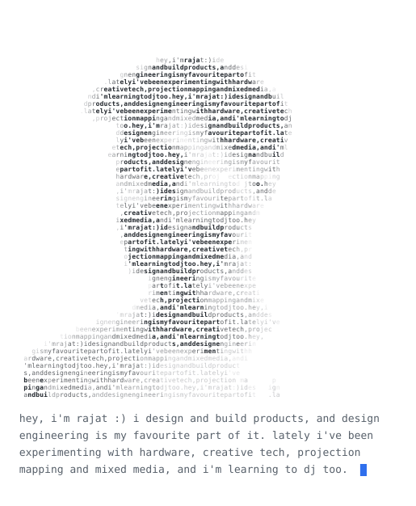

  <picture>
    <source media="(prefers-color-scheme: dark)" srcset="ascii-dark.svg">
    
  </picture>

  <a href="https://x.com/sethiHQ"><picture><source media="(prefers-color-scheme: dark)" srcset="btn-x-dark.svg"></picture></a>&nbsp;&nbsp;&nbsp;
  <a href="https://www.linkedin.com/in/sethihq/"><picture><source media="(prefers-color-scheme: dark)" srcset="btn-linkedin-dark.svg"></picture></a>

