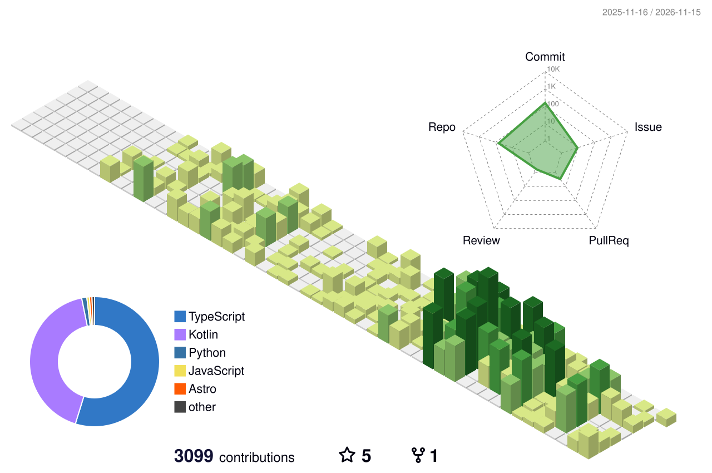

<!-- voice: Farza, personal preset (lowercase, comma sentences, one wink, no dashes). Old version lives in archive/README-2025.md -->

## rajat sethi

i design products and then build them, mostly for the screen, now and then for the desk, with some mixed media and creative tech along the way :)

### things i've made

| | |
| --- | --- |
| **[verse text](https://verse.rajatsethii.in)** | a react component that prints text like a misregistered comic, then keeps it glitching |
| **[the starry night](https://starry.rajatsethii.in)** | a paragraph about the painting that turns into the painting wherever you highlight it |
| **[scrub slider](https://scrub-slider.vercel.app)** | a slider with scrub sounds and haptic feedback, built on radix, numberflow and web audio |
| **[pixel characters](https://github.com/sethihq/pixel-characters)** | animated ascii pixel art for react, which you add to your project as source you own, kinda like shadcn but for little characters |
| **[clawd](https://clawd.rajatsethii.in)** | every pixel skit of clawd, claude code's mascot, redrawn from anthropic's videos as a fan project |
| **[baron home](https://github.com/sethihq/baron-tv)** | a new home screen and a phone remote for a budget 32 inch cloud tv with 512 mb of ram, prototyped on the web first and then built for the tv |
| **[dot grid video](https://github.com/sethihq/playground)** | turns any video into a dot grid animation, with the subject cut out and composited over a pixelated scene |
| **[iso video](https://iso-video.vercel.app)** | turns website screenshots into isometric 3d videos |
| **[experiments](https://experiments-site-pi.vercel.app)** | a gallery of webgl and three.js experiments, a few of them driven by hand tracking and the camera |
| **[orbit](https://0rbit.vercel.app)** | a tiny offline clock after dieter rams, in plain html, css and js |
| **[desengs](https://github.com/sethihq/guide)** | a list of resources for design engineers that anyone can add to |

  

### the green squares

  <picture>
    <source media="(prefers-color-scheme: dark)" srcset="../v2-seesaw-header/profile-3d-contrib/profile-night-rainbow.svg">
    
  </picture>

  <picture>
    <source media="(prefers-color-scheme: dark)" srcset="https://raw.githubusercontent.com/sethihq/sethihq/output/snake-dark.svg">
    
  </picture>

  <picture>
    <source media="(prefers-color-scheme: dark)" srcset="https://streak-stats.demolab.com/?user=sethihq&theme=dark&hide_border=true&background=00000000&ring=5B82FF&fire=EC9ED7&currStreakLabel=EC9ED7">
    
  </picture>

### say hi

if you're working on a weird interaction, a small hardware thing or anything that needs both design and code, i'd love to see it, so come say hi on [x](https://x.com/sethiHQ) or [linkedin](https://www.linkedin.com/in/sethihq/).

  

